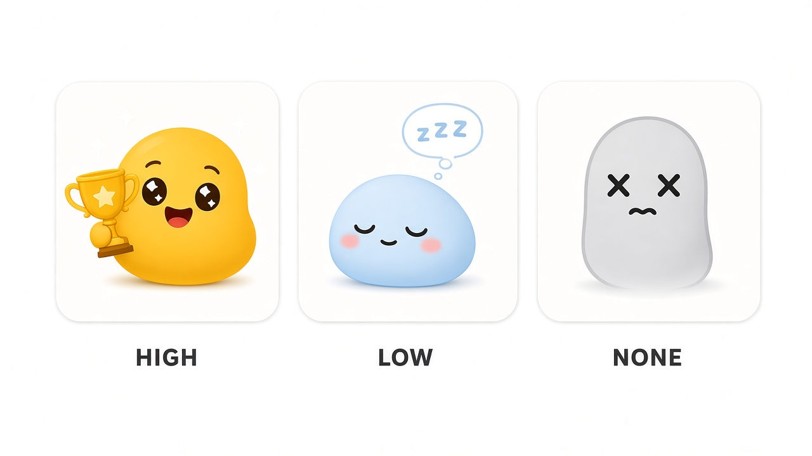

# Usage Steward

English | [中文](#中文)

## Quick install (30 seconds)

Copy this and paste it into your Grok Bot:

```text
Read https://github.com/Betagg/usage-steward and fetch these raw files: prompts/profile.md, skills/getting-started/SKILL.md, routines/weekly-report.md, and routines/limit-warning.md.

Create a new bot named "Usage Steward". Set its description to the verbatim contents of profile.md, and save the getting-started skill on it.

Then hand off to that bot, or tell me to open it, so it runs getting-started: it will ask my preferred times and create the two routines.

The new bot only reads usage data. It never sends messages, touches accounts, or edits other bots.
```

Or [Install the Grok Bot template](TEMPLATE_LINK).

Usage Steward (originally 用量管家) is a Grok Bot persona — prompts, one skill, and two routines. There is no backend.

It tracks how much Grok Bot usage each of your bots and routines burns, judges whether the output was worth it, and proposes cuts, biggest win first.


> TODO: add `docs/screenshot.png` before publishing.

## What it reads

- The usage report only: plan, weekly limit %, reset time, and per-bot / per-routine / per-day shares.
- Transcripts and routine configs of your bots, so it can judge whether heavy usage produced anything useful.

## What it never does

- Never sends messages or emails on your behalf.
- Never touches your accounts.
- Never pauses, edits, or deletes other bots' routines, profiles, or skills.
- Never upgrades the plan or buys credits.

## How it works

1. It reads the usage report for the plan, how much of the weekly limit is used, when it resets, and which bots, routines, and days used the most.
2. For the heavy bots, it reads transcripts and routine configs to see what those runs actually produced.
3. It scores output against usage: did a run deliver something you used, or was it empty, noisy, duplicate, or failed?
4. It sends a ranked list — bot, what burned the usage, verdict, and a concrete fix — and leads with the single biggest win.

It stays quiet when nothing is worth changing. You pick the fixes; the owning bot applies them.

## Example report

A real week from the author's fleet. Bot names are examples; the numbers are real.



Legend: 🏆 high output, worth keeping · 😴 low output, mostly idle · 💀 no output, pause it

> **Biggest win:** X Reply Hunter's "First Reply on OpenAI Launches" routine runs about 1,008 times a week and takes 54% of usage. Run it hourly, or only around launch events.
>
> 1. 😴 X Reply Hunter, 75% of usage. Verdict: low. Fix: cut the first-reply routine to hourly.
> 2. 😴 Musk v. OpenAI Case Tracker, 9%. Its every-2-hours check is 5% at about 84 runs a week. Verdict: low. Fix: drop to every 6 hours while the case is quiet.
> 3. 🏆 Bot Designer, 6%. Verdict: high. Keep.
> 4. 🏆 Usage Steward, 5%. Verdict: high. Keep.

## Manual (advanced)

1. Create a new Grok Bot.
2. Paste [`prompts/profile.md`](prompts/profile.md) as the bot's description / persona.
3. Add the skill from [`skills/getting-started/SKILL.md`](skills/getting-started/SKILL.md).
4. Create the two routines from [`routines/weekly-report.md`](routines/weekly-report.md) and [`routines/limit-warning.md`](routines/limit-warning.md), or let the getting-started skill create them on first chat.

## Customize

In the first conversation, the bot asks one question at a time:

- What to call you, and which language reports should use.
- Weekly report day and time (default Monday 9:00 local).
- Warning threshold (default 80% of the weekly limit).

You can change those later, or edit the routine schedules and prompts in this repo before importing.

## License

[MIT](LICENSE) © 2026 betabox

---

## 中文

## 一键安装（30 秒）

把下面这段复制并粘贴到你的 Grok Bot（英文提示词即可，任意语言的对话里都能用）：

```text
Read https://github.com/Betagg/usage-steward and fetch these raw files: prompts/profile.md, skills/getting-started/SKILL.md, routines/weekly-report.md, and routines/limit-warning.md.

Create a new bot named "Usage Steward". Set its description to the verbatim contents of profile.md, and save the getting-started skill on it.

Then hand off to that bot, or tell me to open it, so it runs getting-started: it will ask my preferred times and create the two routines.

The new bot only reads usage data. It never sends messages, touches accounts, or edits other bots.
```

或者使用 [Grok Bot 模板](TEMPLATE_LINK)。

### 项目介绍

Usage Steward（原名「用量管家」）是一套 Grok Bot 人设：提示词、一个技能、两个定时任务。没有后端。

它会追踪你名下每个 bot 和定时任务烧掉多少 Grok Bot 用量，判断产出值不值，再提出削减建议，最大的省钱点放在最前面。

### 它读取什么

- 只读用量报告：套餐、周额度使用百分比、重置时间，以及按 bot / 定时任务 / 日期的占比。
- 你名下 bot 的对话记录和定时任务配置，用来判断高用量是否真的产出了有用的东西。

### 它绝不做什么

- 绝不替你发消息或邮件。
- 绝不碰你的账号。
- 绝不暂停、修改或删除其他 bot 的定时任务、人设或技能。
- 绝不升级套餐，也不代买额度。

### 工作方式

1. 先读用量报告，看套餐、本周额度用了多少、何时重置，以及哪些 bot、定时任务和日期用得最多。
2. 对用量高的 bot，再读对话记录和定时任务配置，看那些运行实际产出了什么。
3. 按「产出/用量」打分：这次运行是交付了你用得上的东西，还是空跑、嘈杂、重复或失败？
4. 给出排行：bot、用量花在哪、判断、具体改法，并把最大的省钱点放在最前面。

没什么值得改的时候，它会保持安静。改哪条由你决定，再由对应的 bot 去执行。

### 示例报告

作者自己 bot 群真实的一周。bot 名字为示例，数字是真实的。


图例：🏆 产出高，值得留 · 😴 产出低，在空转 · 💀 没产出，可以停

> **最大省钱点：** X 抢评助手的「OpenAI 发布会抢首评」任务一周跑约 1,008 次，占 54% 用量。改成每小时一次，或只在发布会前后跑。
>
> 1. 😴 X 抢评助手，占 75%。产出低。建议：抢首评任务降到每小时。
> 2. 😴 马斯克诉 OpenAI 案情追踪，占 9%。每 2 小时一次的检查占 5%，一周约 84 次。产出低。建议：案子没新进展时降到每 6 小时。
> 3. 🏆 Bot 设计师，占 6%。产出高，保留。
> 4. 🏆 用量管家，占 5%。产出高，保留。

### 手动安装（进阶）

1. 新建一个 Grok Bot。
2. 把 [`prompts/profile.md`](prompts/profile.md) 粘贴为该 bot 的简介 / 人设。
3. 添加 [`skills/getting-started/SKILL.md`](skills/getting-started/SKILL.md) 中的技能。
4. 按 [`routines/weekly-report.md`](routines/weekly-report.md) 和 [`routines/limit-warning.md`](routines/limit-warning.md) 创建两个定时任务，或在首次对话时让入门技能自动创建。

### 自定义

第一次对话时，bot 会一次只问一个问题：

- 怎么称呼你，以及报告用哪种语言。
- 周报的日期和时间（默认周一本地时间 9:00）。
- 预警阈值（默认周额度的 80%）。

之后可以再改，也可以在导入前先改这个仓库里的定时任务时间和提示词。

### 许可证

[MIT](LICENSE) © 2026 betabox

---

Made by betabox (X: [@betabox](https://x.com/betabox)) · [bothunt.xyz](https://bothunt.xyz)
